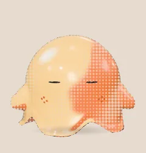
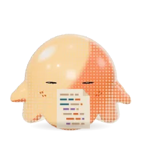

# Claude Blob

A little 3D gummy blob that sits on your desktop, reacts to what your Claude Code
session is doing, and pops up a speech bubble when Claude needs you.

<p align="center"></p>

## Install

You need [Node.js](https://nodejs.org) 22 or later, on your `PATH` so Claude Code's hooks can run it.

1. Clone this repo and install its dependencies:

   ```
   git clone https://github.com/lvanhouten/claude-blob.git
   cd claude-blob
   npm install
   ```

2. Start the blob. It appears in the bottom-right of your primary screen.

   ```
   npm start
   ```

   Or build a standalone Windows app with `npm run package` and run
   `dist\claude-blob-win32-x64\claude-blob.exe`. To start it when you log in, put a shortcut
   to that exe in your Startup folder (press Win+R and run `shell:startup`).

3. [Wire up Claude Code](#wiring-up-claude-code) so the blob hears about your sessions.

4. Check it works: send a prompt in Claude Code and the blob should start thinking. If nothing
   happens, open <http://127.0.0.1:7777/recent> to see the last events the blob received, and
   use **Test notification** in the tray menu to check the blob itself.

`npm run demo` plays a fake session to show every animation, and `npm test` runs the tests.

## Using it

- **Drag** the blob to move it, **click** to jiggle it like jello (or dismiss a bubble), **right-click** (or use the tray icon) for the menu.
- While it's idle, **circle your cursor around its eyes three times** and it spins itself dizzy.
- **Session** in the menu picks which Claude Code session the blob follows: **Auto**, or one session by its project name.
- **Light** in the menu sets where the light comes from: a fixed angle, or **Auto**, which lights him from the center of whichever monitor he's on.
- **Color…** in the menu opens a picker that previews colors on him live; **Apply** keeps one, **Cancel** puts his old color back. You pick his shade color and the rest is worked out from it; the **Lit side** tab lets you pick that one by hand too.
- **Size** in the menu makes him small, medium or large.
- Clicks anywhere else pass straight through to the windows underneath.
- **Animation gallery** (tray or right-click menu, or open `gallery.html` through any local web server) shows every animation looping side by side.

## Wiring up Claude Code

Add these to `~/.claude/settings.json` under `"hooks"`, replacing `/path/to/claude-blob`
with where you cloned this repo. Merge them with any hooks you
already have: each event's array can hold several entries.

```json
"SessionStart":     [{ "hooks": [{ "type": "command", "command": "node /path/to/claude-blob/hook.js", "timeout": 5 }] }],
"UserPromptSubmit": [{ "hooks": [{ "type": "command", "command": "node /path/to/claude-blob/hook.js", "timeout": 5 }] }],
"PreToolUse":       [{ "hooks": [{ "type": "command", "command": "node /path/to/claude-blob/hook.js", "timeout": 5 }] }],
"PostToolUse":      [{ "hooks": [{ "type": "command", "command": "node /path/to/claude-blob/hook.js", "timeout": 5 }] }],
"Notification":     [{ "hooks": [{ "type": "command", "command": "node /path/to/claude-blob/hook.js", "timeout": 5 }] }],
"Stop":             [{ "hooks": [{ "type": "command", "command": "node /path/to/claude-blob/hook.js", "timeout": 5 }] }],
"SubagentStop":     [{ "hooks": [{ "type": "command", "command": "node /path/to/claude-blob/hook.js", "timeout": 5 }] }],
"SessionEnd":       [{ "hooks": [{ "type": "command", "command": "node /path/to/claude-blob/hook.js", "timeout": 5 }] }]
```

`hook.js` forwards only the event name, session id, folder, tool name and notification
message to `127.0.0.1:7777`. It prints nothing and always exits 0 within 1.5s, so it
can't change or stall a session, even when the blob isn't running.

## What it shows

On **Auto**, the blob shows the oldest question still waiting for you, and otherwise the session
that was active most recently. Pick a session in the **Session** menu to follow only that one.

| Claude Code is…                    | The blob…                              |
|------------------------------------|----------------------------------------|
| thinking                           | glances up to one side, then the other, with a "typing…" bubble over his head |
| running a command (Bash)           | a terminal whizzes in, types the command and prints output while he taps away |
| editing files                      | a blank page whizzes in; his arm sweeps down it and the code fills in |
| reading / searching files          | pages of code whizz in one after another and he reads down each one |
| searching the web                  | a browser window types a query, loads, and he reads the results |
| running subagents                  | buds off a mini-me per subagent that circles him, then loops back over his head and lands on top when it finishes |
| waiting for permission             | leans over and waves one arm up high; if you don't answer, he waves both, hops, then glows, and shows the message |
| finished                           | spins and transforms into a star, then back |
| idle for 5 minutes                 | yawns, drifts off with his arms gone limp, and Z's float up |

<table>
<tr><td align="center"><br><sub>Idle</sub></td><td align="center"><br><sub>Thinking</sub></td><td align="center"><br><sub>Running a command</sub></td><td align="center"><br><sub>Editing files</sub></td></tr>
<tr><td align="center"><br><sub>Reading</sub></td><td align="center"><br><sub>Searching the web</sub></td><td align="center"><br><sub>Running subagents</sub></td><td align="center"><br><sub>Needs you</sub></td></tr>
<tr><td align="center"><br><sub>Still needs you</sub></td><td align="center"><br><sub>Finished</sub></td><td align="center"><br><sub>Dozing off</sub></td><td align="center"><br><sub>Asleep</sub></td></tr>
<tr><td align="center"><br><sub>Clicked</sub></td><td align="center"><br><sub>Dizzy</sub></td></tr>
</table>

Notifications from other sessions still show a bubble, labeled with that session's folder.

Set `BLOB_PORT` (for both the app and the hook) to use a port other than 7777.

To check the hooks are reaching the app, open `http://127.0.0.1:7777/recent` to see the last
20 events it received.

## Re-recording the animations

The clips above are rendered frame by frame on a fake clock, then encoded with Pillow:

```
npm run capture            # or: npx electron tools/capture.js done dizzy
python tools/encode.py     # writes docs/media/*.webp
```

The app icon is traced from one rendered idle frame. After changing his shape or colors, redraw it:

```
npx electron tools/icon.js   # renders the frame
python tools/icon.py         # writes assets/icon.ico, tray.png and tray@2x.png
```
